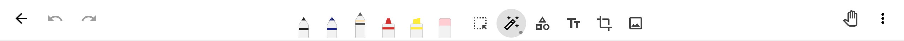
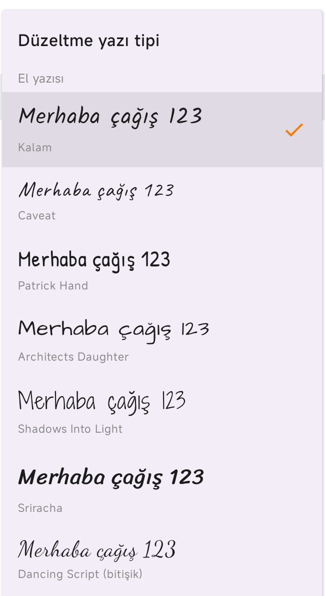

# NeatInk — handwriting notes & PDF study app for Android tablets

**NeatInk** is an offline-first note-taking app for Android tablets, built for solving test questions with a stylus. It feels like the stock Xiaomi Notes app, plus the things it is missing: **PDF import and annotation** and **automatic cleanup of messy handwriting**.

<p align="center">
  <br>
  
</p>

## Download

Get the latest APK from the **[Releases page](https://github.com/Poyraxx/NeatInk/releases/latest)** and open it on your tablet. You may need to allow "Install unknown apps" for your file manager or browser.

Requirements: Android 10 (API 29) or newer. Designed for tablets; it also runs on phones.

## Features

### Handwriting
- Five pens with pressure support: **ballpoint, fountain pen, pencil, marker, highlighter**. Tap a selected pen again to change its width and color.
- **Stroke eraser** and **area eraser**.
- **Lasso**: move, resize, recolor, copy, cut or delete strokes, images and text.
- **Shapes**: draw a shape and hold the pen still for a moment. It snaps to a clean line, arrow, circle, ellipse, triangle, rectangle or polygon.
- Text boxes, images, unlimited undo/redo, and blank, lined, grid or dotted page templates.
- **Palm rejection**: only the pen draws and fingers scroll and zoom. Finger drawing can be turned on.

### Handwriting correction
- **Auto-fix (✨)**: when it is on, words and numbers are cleaned up a moment after you stop writing.
- **Long-press ✨** to pick the font used for the fixed text. There are 7 handwriting fonts and 3 plain fonts, all with full Turkish support (ç ğ ı İ ö ş ü).
- Lasso a part of your writing and tap **Fix** to keep it handwritten but neat, or **To text** to turn it into plain typed text. When the recognizer is unsure, you can pick from its top suggestions.
- Uses Google ML Kit Digital Ink Recognition with a Turkish model. The model (about 20 MB) is downloaded once and then works **fully offline**.

### PDF study mode
- **Import any PDF.** Each PDF page becomes a page you can write on, and the original file is never changed.
- **Solution space**: extend a page to the right or below to get room for working.
- **Cut question**: select a question on a PDF page. You can copy it to the clipboard, send it to a new note, or append it to the current note.
- **Export as PDF** (share or save) with all your ink, including the extended margins.

### Stylus buttons (Xiaomi / Redmi pens)
- **Tap** the lower button for the next pen and the upper button for the previous pen.
- **Hold** either button to erase while held, just like Xiaomi Notes.

HyperOS normally takes over long-presses of the pen buttons (Quick Note / screenshot) in every app except Xiaomi's own. NeatInk avoids this only while a note is open: it turns on HyperOS's "game mode" flag, which stops the system from using the pen buttons, and turns it off again when you leave the note. This needs one permission that can only be granted over USB, once:

```bash
adb shell pm grant com.xaser.note android.permission.WRITE_SECURE_SETTINGS
```

Without it, taps still work, but long-presses open Xiaomi's Quick Note.

### Other
- Text notes with bullet and to-do lists, folders, pinning, search.
- **English / Turkish** interface (Settings ⚙ on the home screen).
- **Works offline.** The app only goes online in two cases: the one-time handwriting model download, and a single update check at startup. The update check runs only if the tablet is online. If a newer release exists, an "Update available" button links to this page. If you are offline, it does not check at all.

## Building from source

1. Install the Android SDK (platform 37), and use JDK 17 or 21.
2. Create `local.properties` with `sdk.dir=/path/to/Android/Sdk`.
3. Build the APK:

```bash
./gradlew assembleRelease      # APK: app/build/outputs/apk/release/app-release.apk
./gradlew testDebugUnitTest    # shape-recognition unit tests
```

Project layout:

| Path | What it does |
|---|---|
| `app/src/main/java/com/xaser/note/ink/` | Canvas (`InkView`), pens, erasers, lasso, shape snapping, stylus buttons |
| `app/src/main/java/com/xaser/note/pdf/` | PDF import, page rendering cache, PDF export |
| `app/src/main/java/com/xaser/note/recognition/` | ML Kit handwriting recognition and text placement |
| `app/src/main/java/com/xaser/note/ui/` | Jetpack Compose screens |
| `version.json` | Latest version info, read by the in-app update check |

### Publishing a new version
1. Increase `versionCode` and `versionName` in `app/build.gradle.kts`.
2. Build the release APK and attach it to a new GitHub release.
3. Update `version.json` with the same `versionCode` and `versionName`. Installed apps will show the update button the next time they start online.

Keep the application ID (`com.xaser.note`) and the signing key the same. Then new versions install over old ones, and each device keeps its own notes.

## Credits

- Handwriting recognition: [Google ML Kit Digital Ink Recognition](https://developers.google.com/ml-kit/vision/digital-ink-recognition)
- Fonts (SIL Open Font License 1.1): Kalam, Caveat, Patrick Hand, Architects Daughter, Shadows Into Light Two, Sriracha and Dancing Script, from [Google Fonts](https://fonts.google.com). See [THIRD_PARTY_NOTICES.md](THIRD_PARTY_NOTICES.md).

## License

The app's source code is released under the [MIT License](LICENSE). Bundled fonts keep their own SIL Open Font License, and ML Kit is subject to Google's terms. See [THIRD_PARTY_NOTICES.md](THIRD_PARTY_NOTICES.md).
